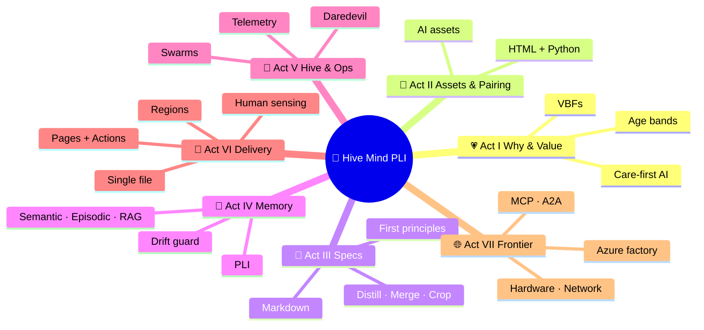

# HMAF-ASI
Hive Minds &amp; Agentic Software Factories - Patterns for Artificial Super Intelligence

# Claude Opus 5.5.

# 🐝 Distributed Hive Mind Agentic Workflows for Progressive Longitudinal Intelligence
### Solving for AI Operations at Scale — an FDE Mentor's Memory Map

> 🧭 **What this file is:** a living Markdown memory map for a 49-slide, 1-minute-per-slide talk.
> Revise it here, then lift and shift into PowerPoint slides and one super HTML app.
> 🔢 **Mnemonic:** **7 Acts × 7 Slides = 49 minutes.** Each act is a "room" you walk through (method of loci).
> 🗓️ Drafted 2026-10-16 · Author: Aaron C. Wacker · AI pair-programming co-author: Claude

---

## 🗺️ Contents

1. 🧱 Part 1 — The 49-Slide Ordered Outline (7 Acts)
2. 🎞️ Part 1b — Slide Cards (three-point mini tables + media slot)
3. 📚 Part 2 — Reference Table (49 papers, arXiv PDF links, keyword targets, videos)
4. 📖 Part 3 — Glossary + Recipe Ticklers (structured vs. unstructured outputs)
5. ⚛️ Part 4 — First-Principles Word Sets + Copy-Paste Prompt Drivers
6. 🔌 Part 5 — AI Protocols & Standards Map (apps, models, how they work)
7. 🔗 Part 6 — Your Links (GitHub, allaiinc.org, past sessions)
8. 🧠 Part 7 — Lift-and-Shift Plan (Markdown → PowerPoint → Super HTML App)

---

## 🧱 Part 1 — The 49-Slide Ordered Outline

**Ordering logic:** *Why → How we build → How we specify → How it remembers → How it scales → How we ship → Where it runs.*
Original topic numbers from your list are shown in brackets, e.g. `[1]`.

### 💗 Act I — The Why and the Value (Slides 1–7)
1. 💗 Share Your Why: Care and Compassion in an AI + Value-Based Care World `[1]`
2. 🏥 How We Get to Better Care and Better AI for Healthcare `[4]`
3. ⚖️ Balancing Speed to Development and Speed to Value Simultaneously `[3]`
4. 📈 Determining Value-Based Factors (VBFs) and Measuring Business Quality and Efficacy `[14]`
5. 👶👵 Representing Age Groups with Ordered CMS Age Groups and Emojis `[20]`
6. 🎤 Engagement Tips `[30]`
7. 🥊 Opportunity Judgment Trade-offs: SWOT, Steel Man, and Straw Man `[31]`

### 🤝 Act II — AI Assets and AI Pair Programming (Slides 8–14)
8. 🧩 Defining AI Assets and AI Pair Programming `[5]`
9. 👥 AI Pair Programming: Traditional Methods vs. the AI Pair Programming Method `[29]`
10. 🔗 AI Code Integration for AI Pair Programming `[49]`
11. 📋 Development Tools: Developer ↔ GitHub ↔ AI — Copying and Pasting Across Tabs and Apps `[38]`
12. 📚 Languages, Libraries, Preferences, and Why `[10]`
13. 🏷️ Language Precedence: Which Keywords and File Types to Invest In `[17]`
14. 🌐🐍 HTML vs. Python: Trade-offs and How to Use Them Together `[11]`

### 📝 Act III — The Craft of Specification (Slides 15–21)
15. 📐 Markdown Structures: How to Develop Great Specifications `[18]`
16. ♻️ Reusable Prompt Specification Patterns `[24]`
17. ⚡ Language Speed-Up Phrasing `[23]`
18. 🗃️ Datasets as Reusable Markdown Specification Templates `[28]`
19. 🪆 Constraint-Based Modeling and Nested Boundaries `[19]`
20. 🔬 First-Principles Asymptotic Reduction of Parts and Process Steps `[21]`
21. ✂️ Minimization Principles: Distill, Merge, and Crop Memory Chunks for Communication `[22]`

### 🧠 Act IV — Memory and Longitudinal Intelligence (Slides 22–28)
22. 🧠 AI Memory: Semantic Memory, Episodic Memory, and RAG with Chroma `[6]`
23. 🗂️ Deciding What to Remember `[34]`
24. 📆 Progressive Longitudinal Intelligence `[36]`
25. 🔁 Patterns of Progressive Longitudinal Intelligence to Solve AI Ops at Scale `[2]`
26. 📦 AI Sets, Models, and Assets: Scale, Cost, and Delivery `[7]`
27. 🧪 Per-Model Qualification: Assets, Memory, Gaps, Upgrades, Drift, and Resilience `[12]`
28. 🏒 Model Efficiency Gains, Performance Measurement, and Playing Where the Puck Is Headed `[13]`

### 🐝 Act V — Hive Minds and AI Operations (Slides 29–35)
29. 🐝 Distributed Hive Minds `[35]`
30. 🕸️ Distributed Hive Mind Agentic Workflows *(the controversial one)* `[15]`
31. 📡 Patterns and Telemetry in AIOps `[27]`
32. 🧮 Web SWOT, Python SWOT, and Azure SWOT `[32]`
33. 🔐 Mixing Complex Python and Azure Patterns: Containers and MFA `[33]`
34. 💸 New Approaches to App Development at Speed, Scale, and Minimal Cost `[37]`
35. 🏍️ Daredevil It: From First Contact to a Runnable Solution in Under Five Minutes (MD → HTML → Python) `[16]`

### 🚀 Act VI — Delivery Patterns (Slides 36–42)
36. 🐍 Python Delivery with Regions, Streamlit, and Markdown-Specification-Led Instruction `[8]`
37. 🏗️ What Regions Look Like in a 30k–40k-Line Multiprocess, Multi-Agent Application `[9]`
38. 📄 Patterns of Outward-Facing Single-File Work `[25]`
39. 🌍 The GitHub Pages Pattern `[26]`
40. ⚙️ GitHub → Actions → HTML/JS App `[42]`
41. 🎬 Demo: Video → Transcript → Structured Markdown Spec → HTML App (All I/O) → Video Out `[41]`
42. 🧍 Real-Time Human Sensing: SSL, WebRTC, PeerJS, Speech, TF.js, and MediaPipe Face/Hand/Body `[43]`

### 🌐 Act VII — Frontier Systems, Protocols, and Infrastructure (Slides 43–49)
43. 🔌 Frontier AI Systems, Multimodal Tools, and Protocols: MCP and A2A `[39]`
44. 🌎 AI in the Wild: GPT, Gemini, Grok, Claude, Meta, HeyGen, and GitHub (Actions, Pages, Copilot, Repos) `[40]`
45. 🛡️ Setup Process: Automating First Principles, the Minimal Necessary, Security, and Architecture `[44]`
46. 🖥️ Hardware and Networks `[45]`
47. 📶 Network Process Activation `[46]`
48. 🏭 Agentic Azure Software Factory Activation `[47]`
49. 🔄 Azure Synchronization `[48]`

---

## 🎞️ Part 1b — Slide Cards

> Each card = one minute: a **🔑 distilled tag** (1–3 words), a **three-point mini table**, and a **🎞️ media slot** (`.png` or `.mp4`).
> Row headers are 1️⃣2️⃣3️⃣; column headers are 🎯 Point / 🗝️ Distilled.

### 💗 Act I — The Why and the Value

#### 1. 💗 Share Your Why — `🔑 Care-First AI` · 🎞️ `s01-why.mp4`
| | 🎯 Point | 🗝️ Distilled |
|---|---|---|
| 1️⃣ | Every model output touches a real person's care relationship. | Person first |
| 2️⃣ | Value-based care pays for outcomes, so AI must improve outcomes, not activity. | Outcomes over output |
| 3️⃣ | Compassion is a design requirement: tone, clarity, and dignity are testable. | Compassion as spec |

#### 2. 🏥 Better Care, Better AI — `🔑 Care ⇄ AI Loop` · 🎞️ `s02-better-care.png`
| | 🎯 Point | 🗝️ Distilled |
|---|---|---|
| 1️⃣ | Better data and documentation lead to better care decisions. | Data quality |
| 2️⃣ | Humans stay in the loop where liability and safety live. | Oversight |
| 3️⃣ | Feedback from care teams becomes the next model's training signal. | Closed loop |

#### 3. ⚖️ Speed to Dev vs. Speed to Value — `🔑 Dual Velocity` · 🎞️ `s03-dual-speed.png`
| | 🎯 Point | 🗝️ Distilled |
|---|---|---|
| 1️⃣ | Fast prototypes prove feasibility; fast value proves worth. | Two clocks |
| 2️⃣ | Ship a runnable slice first, then measure one business metric. | Slice, then score |
| 3️⃣ | Perceived speed-up is not measured speed-up; time it. | Measure, don't feel |

#### 4. 📈 VBFs and Business Quality — `🔑 Measured Value` · 🎞️ `s04-vbf.png`
| | 🎯 Point | 🗝️ Distilled |
|---|---|---|
| 1️⃣ | Define value-based factors before you build (Stars, HEDIS gaps, cost, time). | Metric first |
| 2️⃣ | Compare AI output quality against expert baselines. | Expert baseline |
| 3️⃣ | Efficacy = accuracy × adoption × time saved. | Efficacy formula |

#### 5. 👶👵 CMS Age Groups with Emojis — `🔑 Ordered Age Bands` · 🎞️ `s05-age-bands.png`
| | 🎯 Point | 🗝️ Distilled |
|---|---|---|
| 1️⃣ | Use an ordered key (01, 02, 03…) so bands sort correctly everywhere. | Ordinal keys |
| 2️⃣ | Pair each CMS band with one representative emoji for instant recall. | Picture = 1k words |
| 3️⃣ | Audit model language for age stereotypes in every band. | Age-fair AI |

#### 6. 🎤 Engagement Tips — `🔑 One-Minute Hooks` · 🎞️ `s06-engage.mp4`
| | 🎯 Point | 🗝️ Distilled |
|---|---|---|
| 1️⃣ | Open each slide with a question or a live result. | Hook first |
| 2️⃣ | Show, then tell: a running demo beats a bullet. | Demo > deck |
| 3️⃣ | Give learners a copy-paste prompt to try immediately. | Take-home prompt |

#### 7. 🥊 SWOT, Steel Man, Straw Man — `🔑 Argue Both Sides` · 🎞️ `s07-swot.png`
| | 🎯 Point | 🗝️ Distilled |
|---|---|---|
| 1️⃣ | SWOT frames the opportunity; steel-manning tests it at full strength. | Strongest case |
| 2️⃣ | Straw men reveal weak assumptions you should not build on. | Weak-spot finder |
| 3️⃣ | Let two AI agents debate, and a third judge, before you commit. | Debate, then decide |

### 🤝 Act II — AI Assets and AI Pair Programming

#### 8. 🧩 AI Assets and AI Pair Programming — `🔑 Reusable Intelligence` · 🎞️ `s08-assets.png`
| | 🎯 Point | 🗝️ Distilled |
|---|---|---|
| 1️⃣ | An AI asset is any reusable artifact: spec, prompt, dataset, app, media, memory. | Asset = reusable |
| 2️⃣ | Pair programming = human intent + AI generation + human verification. | Intent → verify |
| 3️⃣ | Assets compound; one-off chats do not. | Compounding |

#### 9. 👥 Traditional vs. AI Pair Programming — `🔑 Driver ⇄ Navigator` · 🎞️ `s09-pairing.mp4`
| | 🎯 Point | 🗝️ Distilled |
|---|---|---|
| 1️⃣ | Traditional: two humans, one keyboard, shared context. | Shared keyboard |
| 2️⃣ | AI method: human pilots intent; AI navigates and drafts. | Pilot + navigator |
| 3️⃣ | The human commits first, then the AI reveals, critiques, and revises. | Commit, then reveal |

#### 10. 🔗 AI Code Integration — `🔑 Merge-Ready AI` · 🎞️ `s10-integration.png`
| | 🎯 Point | 🗝️ Distilled |
|---|---|---|
| 1️⃣ | Integrate in small, reviewable units. | Small diffs |
| 2️⃣ | Capture procedures as reusable skills, not tribal memory. | Codify know-how |
| 3️⃣ | Tests and specs gate every AI contribution. | Gate by spec |

#### 11. 📋 Developer ↔ GitHub ↔ AI Tools — `🔑 Clipboard Pipeline` · 🎞️ `s11-tabs.mp4`
| | 🎯 Point | 🗝️ Distilled |
|---|---|---|
| 1️⃣ | The browser tab is the workbench: chat, repo, preview, docs. | Tab workbench |
| 2️⃣ | Copy-paste is a protocol: spec in, file out, commit. | Paste protocol |
| 3️⃣ | Computer-use agents can now operate the same GUI loop. | GUI agents |

#### 12. 📚 Languages, Libraries, Preferences — `🔑 Stack Choices` · 🎞️ `s12-stack.png`
| | 🎯 Point | 🗝️ Distilled |
|---|---|---|
| 1️⃣ | Python for data and agents; HTML/JS for every screen. | Py + Web |
| 2️⃣ | Prefer CDN-loadable libraries: Three.js, Phaser, PixiJS, MediaPipe, PeerJS. | CDN-first |
| 3️⃣ | LLMs default to Python — state your language explicitly. | Name the language |

#### 13. 🏷️ Language Precedence — `🔑 Keyword Leverage` · 🎞️ `s13-keywords.png`
| | 🎯 Point | 🗝️ Distilled |
|---|---|---|
| 1️⃣ | The first words of a prompt set the frame. | Lead words |
| 2️⃣ | Name the output file type early: `.md`, `.html`, `.py`. | Type early |
| 3️⃣ | Prompt format (Markdown, JSON, YAML) measurably changes results. | Format matters |

#### 14. 🌐🐍 HTML vs. Python — `🔑 Browser + Backend` · 🎞️ `s14-html-py.png`
| | 🎯 Point | 🗝️ Distilled |
|---|---|---|
| 1️⃣ | HTML: zero install, any device, instant share, GPU in the browser. | Zero-install |
| 2️⃣ | Python: data, models, multiprocess agents, enterprise integration. | Heavy lifting |
| 3️⃣ | Pattern: Python produces data and specs; HTML presents and interacts. | Produce → present |

### 📝 Act III — The Craft of Specification

#### 15. 📐 Markdown Structures — `🔑 Spec Is Code` · 🎞️ `s15-md-spec.png`
| | 🎯 Point | 🗝️ Distilled |
|---|---|---|
| 1️⃣ | Outline → table → glossary → references → index. | Five structures |
| 2️⃣ | Headings are contracts; tables are schemas. | Structure = schema |
| 3️⃣ | The spec outlives the code and drives regeneration. | Spec outlives code |

#### 16. ♻️ Reusable Prompt Spec Patterns — `🔑 Prompt Templates` · 🎞️ `s16-patterns.png`
| | 🎯 Point | 🗝️ Distilled |
|---|---|---|
| 1️⃣ | Role → Goal → Inputs → Constraints → Output type → Checks. | Six slots |
| 2️⃣ | Package repeated procedures as skills (SKILL.md folders). | Skills |
| 3️⃣ | Version prompts like code. | Versioned prompts |

#### 17. ⚡ Language Speed-Up Phrasing — `🔑 Dense Words` · 🎞️ `s17-phrasing.mp4`
| | 🎯 Point | 🗝️ Distilled |
|---|---|---|
| 1️⃣ | Use one-, two-, and three-word distilled terms. | Short terms |
| 2️⃣ | Replace paragraphs with lists of nouns and verbs. | Noun-verb lists |
| 3️⃣ | Compress without losing the constraints that matter. | Lossless brevity |

#### 18. 🗃️ Datasets as Markdown Specs — `🔑 Data Templates` · 🎞️ `s18-datasets.png`
| | 🎯 Point | 🗝️ Distilled |
|---|---|---|
| 1️⃣ | Describe columns, types, ranges, and examples in a Markdown table. | Schema table |
| 2️⃣ | Generate synthetic rows from the spec for safe demos. | Synthetic rows |
| 3️⃣ | One spec feeds CSV, JSON, charts, and tests. | One spec, many outputs |

#### 19. 🪆 Constraint-Based Modeling — `🔑 Nested Boundaries` · 🎞️ `s19-nesting.png`
| | 🎯 Point | 🗝️ Distilled |
|---|---|---|
| 1️⃣ | Draw boundaries: person ⊂ episode ⊂ population ⊂ market. | Concentric sets |
| 2️⃣ | Constraints first; feasibility is harder than optimality. | Feasible first |
| 3️⃣ | Each boundary owns its rules, inputs, and outputs. | Boundary contracts |

#### 20. 🔬 First-Principles Reduction — `🔑 Fewer Parts` · 🎞️ `s20-reduce.png`
| | 🎯 Point | 🗝️ Distilled |
|---|---|---|
| 1️⃣ | Remove steps until the system breaks; add one back. | Delete, then restore |
| 2️⃣ | Small recursive systems can beat large static ones. | Less is more |
| 3️⃣ | Asymptote: each pass yields smaller gains — know when to stop. | Diminishing returns |

#### 21. ✂️ Minimization: Distill, Merge, Crop — `🔑 Context Budget` · 🎞️ `s21-distill.png`
| | 🎯 Point | 🗝️ Distilled |
|---|---|---|
| 1️⃣ | Distill: aim for ~120:1 summaries with references. | Distill |
| 2️⃣ | Merge: combine overlapping chunks into one canonical chunk. | Merge |
| 3️⃣ | Crop: keep only what the next agent needs. | Crop |

### 🧠 Act IV — Memory and Longitudinal Intelligence

#### 22. 🧠 Semantic, Episodic, and RAG Memory — `🔑 Memory Types` · 🎞️ `s22-memory.png`
| | 🎯 Point | 🗝️ Distilled |
|---|---|---|
| 1️⃣ | Semantic memory = facts; episodic memory = timestamped events. | Facts vs. events |
| 2️⃣ | RAG retrieves relevant chunks from a vector store such as Chroma. | Retrieve, then reason |
| 3️⃣ | Agentic RAG lets the agent decide when and what to retrieve. | Agentic retrieval |

#### 23. 🗂️ Deciding What to Remember — `🔑 Memory Policy` · 🎞️ `s23-remember.png`
| | 🎯 Point | 🗝️ Distilled |
|---|---|---|
| 1️⃣ | Remember what is durable, reused, and costly to re-derive. | Durable + reused |
| 2️⃣ | Forget what is transient or re-queryable. | Forget transient |
| 3️⃣ | Order and rank memories (largest to smallest) for recall. | Ordinal recall |

#### 24. 📆 Progressive Longitudinal Intelligence — `🔑 Timeline Learning` · 🎞️ `s24-pli.mp4`
| | 🎯 Point | 🗝️ Distilled |
|---|---|---|
| 1️⃣ | Every person has a timeline of episodes. | Person timeline |
| 2️⃣ | Each new event updates the summary instead of rebuilding it. | Progressive update |
| 3️⃣ | Temporal reasoning remains hard — verify ordering and causality. | Check time order |

#### 25. 🔁 PLI Patterns for AI Ops at Scale — `🔑 Shift Cycles` · 🎞️ `s25-cycles.png`
| | 🎯 Point | 🗝️ Distilled |
|---|---|---|
| 1️⃣ | Run cycles at fixed checkpoints (06:00, 12:00, 18:00, 24:00). | Four checkpoints |
| 2️⃣ | Each cycle normalizes cumulative output for review. | Normalize |
| 3️⃣ | Agents self-improve from each cycle's results. | Self-evolving |

#### 26. 📦 AI Sets: Scale, Cost, Delivery — `🔑 Right-Size Models` · 🎞️ `s26-cost.png`
| | 🎯 Point | 🗝️ Distilled |
|---|---|---|
| 1️⃣ | Route easy work to small models and hard work to large ones. | Routing |
| 2️⃣ | Cascade: escalate only when confidence is low. | Cascade |
| 3️⃣ | Track cost per outcome, not cost per token. | Cost per outcome |

#### 27. 🧪 Per-Model Qualification — `🔑 Drift Guard` · 🎞️ `s27-drift.png`
| | 🎯 Point | 🗝️ Distilled |
|---|---|---|
| 1️⃣ | Keep a golden test set per model and per prompt. | Golden set |
| 2️⃣ | Re-qualify on every upgrade; behavior can drift silently. | Re-qualify |
| 3️⃣ | Migrate prompts deliberately, with a testbed. | Prompt migration |

#### 28. 🏒 Where the Puck Is Headed — `🔑 Task Horizon` · 🎞️ `s28-puck.png`
| | 🎯 Point | 🗝️ Distilled |
|---|---|---|
| 1️⃣ | Measure AI by the length of tasks it can complete. | Time horizon |
| 2️⃣ | That horizon has been doubling on a regular cadence. | Doubling trend |
| 3️⃣ | Design today for the agent you will have next year. | Build ahead |

### 🐝 Act V — Hive Minds and AI Operations

#### 29. 🐝 Distributed Hive Minds — `🔑 Collective Intelligence` · 🎞️ `s29-hive.mp4`
| | 🎯 Point | 🗝️ Distilled |
|---|---|---|
| 1️⃣ | Many diverse agents can out-reason one agent on logic-heavy tasks. | Swarm reasoning |
| 2️⃣ | Humans hold judgment; the swarm holds shared memory. | Human judgment |
| 3️⃣ | Organizational intelligence = people + agents + memory. | Org intelligence |

#### 30. 🕸️ Hive Mind Agentic Workflows — `🔑 Swarm Pipelines` · 🎞️ `s30-swarm.png`
| | 🎯 Point | 🗝️ Distilled |
|---|---|---|
| 1️⃣ | Steel man: decentralized coordination scales and adapts. | Coordination scaling |
| 2️⃣ | Straw man: multi-agent systems often fail on specs and handoffs. | Known failure modes |
| 3️⃣ | Resolve with explicit roles, verification, and telemetry. | Roles + checks |

#### 31. 📡 Patterns and Telemetry in AIOps — `🔑 Observe Everything` · 🎞️ `s31-telemetry.png`
| | 🎯 Point | 🗝️ Distilled |
|---|---|---|
| 1️⃣ | Trace every agent step: input, tool, output, cost, latency. | Traces + spans |
| 2️⃣ | Show per-minute and per-hour rates on a live panel. | Live rates |
| 3️⃣ | Alert on drift, loops, and cost spikes. | Alerting |

#### 32. 🧮 Web, Python, and Azure SWOT — `🔑 Platform SWOT` · 🎞️ `s32-swot3.png`
| | 🎯 Point | 🗝️ Distilled |
|---|---|---|
| 1️⃣ | Web: reach and speed; weaker for secrets and heavy compute. | Reach |
| 2️⃣ | Python: power and libraries; heavier to share. | Power |
| 3️⃣ | Azure: governance and scale; slower setup and higher cost. | Governance |

#### 33. 🔐 Python + Azure: Containers and MFA — `🔑 Secure Runtime` · 🎞️ `s33-secure.png`
| | 🎯 Point | 🗝️ Distilled |
|---|---|---|
| 1️⃣ | Containerize agents; treat generated code as untrusted. | Sandbox |
| 2️⃣ | MFA and least privilege on every identity, human or agent. | Least privilege |
| 3️⃣ | Tool protocols such as MCP need explicit trust boundaries. | Trust boundaries |

#### 34. 💸 AppDev at Speed, Scale, Minimal Cost — `🔑 Do More With Less` · 🎞️ `s34-lowcost.png`
| | 🎯 Point | 🗝️ Distilled |
|---|---|---|
| 1️⃣ | 700+ single-file apps prove the speed of the web model. | Proof by volume |
| 2️⃣ | Static hosting + browser compute ≈ near-zero marginal cost. | Near-zero cost |
| 3️⃣ | Route models by task to keep inference spend low. | Cost routing |

#### 35. 🏍️ Daredevil It — `🔑 Five-Minute Runnable` · 🎞️ `s35-daredevil.mp4`
| | 🎯 Point | 🗝️ Distilled |
|---|---|---|
| 1️⃣ | First output is a runnable graph, not a document. | Runnable first |
| 2️⃣ | Progression: Markdown spec → HTML app → Python service. | MD → HTML → Py |
| 3️⃣ | Speed is safe only when the spec gates the result. | Spec-gated speed |

### 🚀 Act VI — Delivery Patterns

#### 36. 🐍 Regions, Streamlit, and Spec-Led Python — `🔑 Region Pattern` · 🎞️ `s36-regions.png`
| | 🎯 Point | 🗝️ Distilled |
|---|---|---|
| 1️⃣ | A region = one bounded block of code with one job and one spec. | Bounded blocks |
| 2️⃣ | Streamlit turns regions into UI panels quickly. | Fast UI |
| 3️⃣ | Markdown instructions tell the AI which region to change. | Region-targeted edits |

#### 37. 🏗️ Regions at 30k–40k Lines — `🔑 Large-System Map` · 🎞️ `s37-bigapp.png`
| | 🎯 Point | 🗝️ Distilled |
|---|---|---|
| 1️⃣ | Region index = table of contents for humans and agents. | Region index |
| 2️⃣ | Multiprocess agents communicate through files and queues. | File + queue |
| 3️⃣ | Most failures are design and handoff failures, not model failures. | Design matters |

#### 38. 📄 Outward-Facing Single-File Work — `🔑 One File, Any Device` · 🎞️ `s38-singlefile.png`
| | 🎯 Point | 🗝️ Distilled |
|---|---|---|
| 1️⃣ | One HTML file = app + docs + demo. | Self-contained |
| 2️⃣ | CDN libraries; no npm; no server. | Zero build |
| 3️⃣ | Local inference keeps data on the device. | Private by default |

#### 39. 🌍 The GitHub Pages Pattern — `🔑 Push = Publish` · 🎞️ `s39-pages.png`
| | 🎯 Point | 🗝️ Distilled |
|---|---|---|
| 1️⃣ | Commit an HTML file and it is live on a custom domain. | Push to publish |
| 2️⃣ | The gallery index becomes the course catalog. | Gallery = catalog |
| 3️⃣ | Version history is the learning journal. | Commits = journal |

#### 40. ⚙️ GitHub → Actions → HTML/JS — `🔑 Automated Gallery` · 🎞️ `s40-actions.mp4`
| | 🎯 Point | 🗝️ Distilled |
|---|---|---|
| 1️⃣ | Actions rebuild the index on each commit. | Auto-index |
| 2️⃣ | Sort newest-first by commit date. | Newest first |
| 3️⃣ | Check CI results before trusting an agent's change. | CI gate |

#### 41. 🎬 Video → Transcript → Spec → App → Video — `🔑 Full I/O Loop` · 🎞️ `s41-loop.mp4`
| | 🎯 Point | 🗝️ Distilled |
|---|---|---|
| 1️⃣ | Transcribe a talk; timestamp the key moments. | Transcribe |
| 2️⃣ | Structure the transcript into a Markdown spec. | Structure |
| 3️⃣ | Generate the HTML app, record it, and publish the MP4. | Build + record |

#### 42. 🧍 Real-Time Human Sensing — `🔑 Sense, Speak, Share` · 🎞️ `s42-sensing.mp4`
| | 🎯 Point | 🗝️ Distilled |
|---|---|---|
| 1️⃣ | Camera → MediaPipe face, hand, and body landmarks in the browser. | Sense |
| 2️⃣ | Microphone → speech-to-text; text → speech synthesis. | Speak |
| 3️⃣ | WebRTC/PeerJS over SSL share streams between users. | Share |

### 🌐 Act VII — Frontier Systems, Protocols, and Infrastructure

#### 43. 🔌 MCP and A2A — `🔑 Agent Interop` · 🎞️ `s43-protocols.png`
| | 🎯 Point | 🗝️ Distilled |
|---|---|---|
| 1️⃣ | MCP connects a model to tools and data. | Model ↔ tools |
| 2️⃣ | A2A connects agents to other agents. | Agent ↔ agent |
| 3️⃣ | Adopt in phases: tools first, then agent collaboration. | Phased adoption |

#### 44. 🌎 AI in the Wild — `🔑 Multi-Model Field Kit` · 🎞️ `s44-wild.mp4`
| | 🎯 Point | 🗝️ Distilled |
|---|---|---|
| 1️⃣ | Use each model for what it does best; compare A/B. | Best tool per task |
| 2️⃣ | Video avatars (HeyGen) and code hosts (GitHub) close the loop. | Media + code |
| 3️⃣ | Public apps + live MCP tools = runnable memory. | Runnable memory |

#### 45. 🛡️ Setup, Security, and Architecture — `🔑 Minimal Necessary` · 🎞️ `s45-setup.png`
| | 🎯 Point | 🗝️ Distilled |
|---|---|---|
| 1️⃣ | Automate setup as a reusable skill or script. | Scripted setup |
| 2️⃣ | Install only what is necessary; every dependency is risk. | Minimal surface |
| 3️⃣ | Architecture = boundaries + permissions + logs. | Bounded design |

#### 46. 🖥️ Hardware and Networks — `🔑 Edge + Cloud` · 🎞️ `s46-hardware.png`
| | 🎯 Point | 🗝️ Distilled |
|---|---|---|
| 1️⃣ | Test on every device class: tablets, foldables, laptops, GPUs. | Device matrix |
| 2️⃣ | Push light inference to the edge; keep heavy work in the cloud. | Edge/cloud split |
| 3️⃣ | Bandwidth and latency budgets shape the design. | Network budget |

#### 47. 📶 Network Process Activation — `🔑 Wake the Swarm` · 🎞️ `s47-activate.mp4`
| | 🎯 Point | 🗝️ Distilled |
|---|---|---|
| 1️⃣ | Nodes discover, handshake, and announce capabilities. | Discover |
| 2️⃣ | Agents coordinate with limited local information. | Local rules |
| 3️⃣ | Health checks confirm the network is live before work starts. | Health check |

#### 48. 🏭 Agentic Azure Software Factory Activation — `🔑 Dark Factory On` · 🎞️ `s48-factory.mp4`
| | 🎯 Point | 🗝️ Distilled |
|---|---|---|
| 1️⃣ | Six agents: Organization, Market, Vision, Summary, Publication, Performance. | Six-agent line |
| 2️⃣ | Each agent has a spec, inputs, outputs, and an evaluator. | Spec + eval |
| 3️⃣ | Healthcare deployment requires near-total human oversight. | Oversight |

#### 49. 🔄 Azure Synchronization — `🔑 One Source of Truth` · 🎞️ `s49-sync.png`
| | 🎯 Point | 🗝️ Distilled |
|---|---|---|
| 1️⃣ | Sync specs, data, and memory on a schedule. | Scheduled sync |
| 2️⃣ | Resolve conflicts by timestamp and owner. | Conflict rules |
| 3️⃣ | Retrieval indexes refresh with every sync. | Fresh index |

---

## 📚 Part 2 — Reference Table (49 Papers + Bonus Shelf)

**Legend:** 📄 = arXiv PDF · 🟢 = 2025–2026 · 🟡 = 2024 preprint later published or revised in 2025 · ↺ = reused paper · 📕 = peer-reviewed, not on arXiv · 📺 = video for independent study
Every link below came from a live search on 2026-10-16. Verify before presenting.

### 💗 Act I
| # | 🏷️ | Slide | 📄 Best-Match Paper | 🔗 PDF | 🎯 Keyword Targets | 📺 Video |
|---|---|---|---|---|---|---|
| 1 | 💗 | Share Your Why | Reinventing Clinical Dialogue: Agentic Paradigms for LLM Enabled Healthcare Communication 🟢 | [2512.01453](https://arxiv.org/pdf/2512.01453) | empathy · clinical dialogue · agentic care | — |
| 2 | 🏥 | Better Care, Better AI | The Doctor Will (Still) See You Now: On the Structural Limits of Agentic AI in Healthcare 🟢 | [2602.18460](https://arxiv.org/pdf/2602.18460) | human oversight · liability · healthcare agents | — |
| 3 | ⚖️ | Speed to Dev vs. Value | Measuring the Impact of Early-2025 AI on Experienced Open-Source Developer Productivity 🟢 | [2507.09089](https://arxiv.org/pdf/2507.09089) | RCT · perceived vs. actual speed-up | — |
| 4 | 📈 | VBFs & Business Quality | GDPval: Evaluating AI Model Performance on Real-World Economically Valuable Tasks 🟢 | [2510.04374](https://arxiv.org/pdf/2510.04374) | economic value · expert baseline · deliverable quality | — |
| 5 | 👶👵 | CMS Age Groups | Examining Age-Bias and Stereotypes of Aging in LLMs (ACM ASSETS 2025) 📕 | [DOI 10.1145/3663547.3746464](https://doi.org/10.1145/3663547.3746464) | ageism · older adults · stereotypes | — |
| 6 | 🎤 | Engagement Tips | Impact of LLM-Based AI Tools on Physician-Patient Communication: Systematic Review and Meta-Analysis (JMIR 2026) 📕 | [jmir.org/2026/1/e77307](https://www.jmir.org/2026/1/e77307) | engagement · clarity · trust | [Karpathy: Software Is Changing (Again)](https://www.youtube.com/watch?v=LCEmiRjPEtQ) |
| 7 | 🥊 | SWOT / Steel / Straw | Can LLM Agents Really Debate? A Controlled Study of Multi-Agent Debate in Logical Reasoning 🟢 | [2511.07784](https://arxiv.org/pdf/2511.07784) | debate · critique · judge | — |

### 🤝 Act II
| # | 🏷️ | Slide | 📄 Best-Match Paper | 🔗 PDF | 🎯 Keyword Targets | 📺 Video |
|---|---|---|---|---|---|---|
| 8 | 🧩 | AI Assets & Pairing | A Survey of Vibe Coding with Large Language Models 🟢 | [2510.12399](https://arxiv.org/pdf/2510.12399) | human–project–agent triad · context engineering | [Karpathy: Software 3.0](https://www.youtube.com/watch?v=LCEmiRjPEtQ) |
| 9 | 👥 | Traditional vs. AI Pairing | Agentic Software Engineering: Foundational Pillars and a Research Roadmap 🟢 | [2509.06216](https://arxiv.org/pdf/2509.06216) | SE 3.0 · SE for humans / SE for agents | — |
| 10 | 🔗 | AI Code Integration | Multi-Agent Procedural Knowledge Extraction 🟢 | [2603.11808](https://arxiv.org/pdf/2603.11808) | SKILL.md · codebase → skills | [Don't Build Agents, Build Skills Instead](https://www.youtube.com/watch?v=CEvIs9y1uog) |
| 11 | 📋 | Dev Tools / Tabs | OS Agents: A Survey on MLLM-based Agents for General Computing Devices Use 🟢 | [2508.04482](https://arxiv.org/pdf/2508.04482) | GUI agents · browser use · computer use | — |
| 12 | 📚 | Languages & Libraries | A Study of LLMs' Preferences for Libraries and Programming Languages (formerly "LLMs Love Python") 🟢 | [2503.17181](https://arxiv.org/pdf/2503.17181) | Python bias · library bias | — |
| 13 | 🏷️ | Language Precedence | Does Prompt Formatting Have Any Impact on LLM Performance? 🟡 | [2411.10541](https://arxiv.org/pdf/2411.10541) | Markdown · JSON · YAML · format sensitivity | — |
| 14 | 🌐🐍 | HTML vs. Python | WebLLM: A High-Performance In-Browser LLM Inference Engine 🟡 | [2412.15803](https://arxiv.org/pdf/2412.15803) | WebGPU · WASM · in-browser inference | — |

### 📝 Act III
| # | 🏷️ | Slide | 📄 Best-Match Paper | 🔗 PDF | 🎯 Keyword Targets | 📺 Video |
|---|---|---|---|---|---|---|
| 15 | 📐 | Markdown Structures | SpecMine: A Large-Scale Corpus of Spec-Driven Development Artifacts 🟢 | [2608.25202](https://arxiv.org/pdf/2608.25202) | spec files · intent layer · SDD tools | [Sean Grove: The New Code](https://ai.engineer/talks/specifications-are-the-new-code) |
| 16 | ♻️ | Reusable Prompt Specs | Agent Skills for Large Language Models: Architecture, Acquisition, Security, and the Path Forward 🟢 | [2602.12430](https://arxiv.org/pdf/2602.12430) | SKILL.md · progressive disclosure | [Build Skills Instead](https://www.youtube.com/watch?v=CEvIs9y1uog) |
| 17 | ⚡ | Speed-Up Phrasing | Prompt Compression for Large Language Models: A Survey (NAACL 2025) 🟡 | [2410.12388](https://arxiv.org/pdf/2410.12388) | hard/soft prompts · compression ratio | — |
| 18 | 🗃️ | Datasets as Specs | Synthetic Data Generation Using Large Language Models: Advances in Text and Code 🟢 | [2503.14023](https://arxiv.org/pdf/2503.14023) | synthetic data · text · code | — |
| 19 | 🪆 | Constraints & Boundaries | ConstraintBench: Benchmarking LLM Constraint Reasoning on Direct Optimization 🟢 | [2602.22465](https://arxiv.org/pdf/2602.22465) | feasibility · optimality · constraints | — |
| 20 | 🔬 | First-Principles Reduction | Less is More: Recursive Reasoning with Tiny Networks 🟢 | [2510.04871](https://arxiv.org/pdf/2510.04871) | tiny recursive model · 2 layers · 7M params | — |
| 21 | ✂️ | Distill / Merge / Crop | A Survey of Context Engineering for Large Language Models 🟢 | [2507.13334](https://arxiv.org/pdf/2507.13334) | context retrieval · processing · management | [Barry Zhang: How We Build Effective Agents](https://www.youtube.com/watch?v=D7_ipDqhtwk) |

### 🧠 Act IV
| # | 🏷️ | Slide | 📄 Best-Match Paper | 🔗 PDF | 🎯 Keyword Targets | 📺 Video |
|---|---|---|---|---|---|---|
| 22 | 🧠 | Semantic / Episodic / RAG | Memory in the Age of AI Agents 🟢 | [2512.13564](https://arxiv.org/pdf/2512.13564) | token · parametric · latent memory | — |
| 23 | 🗂️ | What to Remember | A Survey of Agent Memory in the Second Half: Towards Self-Evolving and Long-Horizon Agents 🟢 | [2602.06052](https://arxiv.org/pdf/2602.06052) | episodic memory · episode boundaries · retention | — |
| 24 | 📆 | Progressive Longitudinal Intelligence | Large Language Models with Temporal Reasoning for Longitudinal Clinical Summarization and Prediction 🟢 | [2501.18724](https://arxiv.org/pdf/2501.18724) | patient trajectory · EHR · temporal reasoning | — |
| 25 | 🔁 | PLI for AI Ops | A Survey of Self-Evolving Agents: What, When, How, and Where to Evolve on the Path to Artificial Super Intelligence 🟢 | [2507.21046](https://arxiv.org/pdf/2507.21046) | self-evolving · continual adaptation | — |
| 26 | 📦 | Scale, Cost, Delivery | Towards Efficient Multi-LLM Inference: Characterization and Analysis of LLM Routing and Hierarchical Techniques 🟢 | [2506.06579](https://arxiv.org/pdf/2506.06579) | routing · cascading · edge | — |
| 27 | 🧪 | Per-Model Qualification | Prompt Migration: Stabilizing GenAI Applications with Evolving Large Language Models 🟢 | [2507.05573](https://arxiv.org/pdf/2507.05573) | drift · migration testbed · regression | — |
| 28 | 🏒 | Where the Puck Is Headed | Measuring AI Ability to Complete Long Tasks 🟢 | [2503.14499](https://arxiv.org/pdf/2503.14499) | 50% time horizon · ~7-month doubling | [Lex #490: State of AI in 2026](https://lexfridman.com/ai-sota-2026/) |

### 🐝 Act V
| # | 🏷️ | Slide | 📄 Best-Match Paper | 🔗 PDF | 🎯 Keyword Targets | 📺 Video |
|---|---|---|---|---|---|---|
| 29 | 🐝 | Distributed Hive Minds | The Society of HiveMind: Multi-Agent Optimization of Foundation Model Swarms to Unlock the Potential of Collective Intelligence 🟢 | [2503.05473](https://arxiv.org/pdf/2503.05473) | swarm · collective intelligence · logical reasoning | [Andrew Ng: Agentic Workflows (2024)](https://www.youtube.com/watch?v=sal78ACtGTc) |
| 30 | 🕸️ | Hive Agentic Workflows | SwarmSys: Decentralized Swarm-Inspired Agents for Scalable and Adaptive Reasoning 🟢 | [2510.10047](https://arxiv.org/pdf/2510.10047) | coordination scaling · decentralized | [Andrew Ng: State of AI Agents (2025)](https://www.youtube.com/watch?v=4pYzYmSdSH4) |
| 31 | 📡 | Telemetry in AIOps | Taming Uncertainty via Automation: Observing, Analyzing, and Optimizing Agentic AI Systems 🟢 | [2507.11277](https://arxiv.org/pdf/2507.11277) | AgentOps · observability · self-healing | — |
| 32 | 🧮 | Web / Python / Azure SWOT | When OpenClaw Meets Hospital: Toward an Agentic Operating System for Dynamic Clinical Workflows 🟢 | [2603.11721](https://arxiv.org/pdf/2603.11721) | open vs. regulated environments · restricted execution | [Lex #491: OpenClaw](https://www.youtube.com/watch?v=YFjfBk8HI5o) |
| 33 | 🔐 | Containers & MFA | Model Context Protocol (MCP): Landscape, Security Threats, and Future Research Directions 🟢 | [2503.23278](https://arxiv.org/pdf/2503.23278) | threat taxonomy · lifecycle · safeguards | — |
| 34 | 💸 | Speed, Scale, Minimal Cost | Doing More with Less – Implementing Routing Strategies in Large Language Model-Based Systems: An Extended Survey 🟢 | [2502.00409](https://arxiv.org/pdf/2502.00409) | cost minimization · routing | — |
| 35 | 🏍️ | Daredevil It | Spec-Driven Development: From Code to Contract in the Age of AI Coding Assistants 🟢 | [2602.00180](https://arxiv.org/pdf/2602.00180) | spec-first · spec-anchored · spec-as-source | [Sean Grove: The New Code](https://ai.engineer/talks/specifications-are-the-new-code) |

### 🚀 Act VI
| # | 🏷️ | Slide | 📄 Best-Match Paper | 🔗 PDF | 🎯 Keyword Targets | 📺 Video |
|---|---|---|---|---|---|---|
| 36 | 🐍 | Regions + Streamlit + Spec | Authoring Agent Skills: A Software-Engineering Approach 🟢 | [2607.25032](https://arxiv.org/pdf/2607.25032) | skills as software · coupling · SKILL.md | — |
| 37 | 🏗️ | 30k–40k-Line Regions | Why Do Multi-Agent LLM Systems Fail? 🟢 | [2503.13657](https://arxiv.org/pdf/2503.13657) | MAST · 14 failure modes · inter-agent misalignment | — |
| 38 | 📄 | Single-File Work | WebLLM: A High-Performance In-Browser LLM Inference Engine 🟡 ↺ | [2412.15803](https://arxiv.org/pdf/2412.15803) | local · private · browser GPU | — |
| 39 | 🌍 | GitHub Pages Pattern | AIDev: Studying AI Coding Agents on GitHub 🟢 | [2602.09185](https://arxiv.org/pdf/2602.09185) | agentic PRs · Codex · Copilot · Claude Code | — |
| 40 | ⚙️ | GitHub → Actions → HTML | Where Do AI Coding Agents Fail? An Empirical Study of Failed Agentic Pull Requests in GitHub 🟢 | [2601.15195](https://arxiv.org/pdf/2601.15195) | CI builds · merge outcomes · review dynamics | — |
| 41 | 🎬 | Video → Spec → App → Video | A Survey on Video Temporal Grounding with Multimodal Large Language Model 🟢 | [2508.10922](https://arxiv.org/pdf/2508.10922) | timestamps · video LLMs · grounding | — |
| 42 | 🧍 | Real-Time Human Sensing | From Turn-Taking to Synchronous Dialogue: A Survey of Full-Duplex Spoken Language Models 🟢 | [2509.14515](https://arxiv.org/pdf/2509.14515) | full-duplex · turn-taking · voice agents | — |

### 🌐 Act VII
| # | 🏷️ | Slide | 📄 Best-Match Paper | 🔗 PDF | 🎯 Keyword Targets | 📺 Video |
|---|---|---|---|---|---|---|
| 43 | 🔌 | MCP and A2A | A Survey of Agent Interoperability Protocols: MCP, ACP, A2A, and ANP 🟢 | [2505.02279](https://arxiv.org/pdf/2505.02279) | JSON-RPC · Agent Cards · DIDs | [Mahesh Murag: Building Agents with MCP](https://www.youtube.com/watch?v=kQmXtrmQ5Zg) |
| 44 | 🌎 | AI in the Wild | Dynamic Model Routing and Cascading for Efficient LLM Inference: A Survey 🟢 | [2603.04445](https://arxiv.org/pdf/2603.04445) | multi-LLM · routing paradigms | [Lex #490](https://lexfridman.com/ai-sota-2026/) |
| 45 | 🛡️ | Setup & Security | SoK: Agentic Skills – Beyond Tool Use in LLM Agents 🟢 | [2602.20867](https://arxiv.org/pdf/2602.20867) | skill supply chain · governance | — |
| 46 | 🖥️ | Hardware & Networks | Network Edge Inference for Large Language Models: Principles, Techniques, and Opportunities 🟢 | [2604.22906](https://arxiv.org/pdf/2604.22906) | edge nodes · bandwidth · energy | — |
| 47 | 📶 | Network Activation | Benchmarking LLMs' Swarm Intelligence 🟢 | [2505.04364](https://arxiv.org/pdf/2505.04364) | local perception · decentralized coordination | — |
| 48 | 🏭 | Azure Software Factory | Agentic AI in Healthcare & Medicine: A Seven-Dimensional Taxonomy for Empirical Evaluation of LLM-based Agents 🟢 | [2602.04813](https://arxiv.org/pdf/2602.04813) | healthcare agents · evaluation taxonomy | [Barry Zhang: Effective Agents](https://www.youtube.com/watch?v=D7_ipDqhtwk) |
| 49 | 🔄 | Azure Synchronization | Agentic Retrieval-Augmented Generation: A Survey on Agentic RAG 🟢 | [2501.09136](https://arxiv.org/pdf/2501.09136) | dynamic retrieval · index freshness | — |

### ➕ Bonus Shelf (keyword targets for deeper study)
| # | 🏷️ | Paper | 🔗 | Pairs With |
|---|---|---|---|---|
| B1 | ✂️ | HiChunk: Evaluating and Enhancing Retrieval-Augmented Generation with Hierarchical Chunking 🟢 | [2509.11552](https://arxiv.org/pdf/2509.11552) | Slides 21, 22 |
| B2 | 🧰 | ProcMEM: Learning Reusable Procedural Memory from Experience via Non-Parametric PPO for LLM Agents 🟢 | [2602.01869](https://arxiv.org/pdf/2602.01869) | Slides 16, 23 |
| B3 | 🗣️ | On the Landscape of Spoken Language Models: A Comprehensive Survey 🟢 | [2504.08528](https://arxiv.org/pdf/2504.08528) | Slide 42 |
| B4 | 🎥 | Video Understanding with Large Language Models: A Survey (revised 2025) 🟡 | [2312.17432](https://arxiv.org/pdf/2312.17432) | Slide 41 |
| B5 | 🩺 | A Survey of LLM-based Agents in Medicine: How far are we from Baymax? 🟢 | [2502.11211](https://arxiv.org/pdf/2502.11211) | Slides 2, 48 |
| B6 | ⏱️ | TCP: A Benchmark for Temporal Constraint-Based Planning 🟢 | [2505.19927](https://arxiv.org/pdf/2505.19927) | Slides 19, 24 |
| B7 | 🥊 | Literature Review of Multi-Agent Debate for Problem-Solving 🟢 | [2506.00066](https://arxiv.org/pdf/2506.00066) | Slide 7 |

### 📺 Video Shelf (verified links)
| # | 📺 Talk | Speaker | Link | Slides |
|---|---|---|---|---|
| V1 | Software Is Changing (Again) — Software 3.0 | Andrej Karpathy (YC AI Startup School, 2025) | [youtube.com/watch?v=LCEmiRjPEtQ](https://www.youtube.com/watch?v=LCEmiRjPEtQ) | 6, 8, 14 |
| V2 | The New Code — specifications as code | Sean Grove, OpenAI | [ai.engineer/talks/specifications-are-the-new-code](https://ai.engineer/talks/specifications-are-the-new-code) | 15, 35 |
| V3 | Building Agents with Model Context Protocol (workshop) | Mahesh Murag, Anthropic | [youtube.com/watch?v=kQmXtrmQ5Zg](https://www.youtube.com/watch?v=kQmXtrmQ5Zg) | 43 |
| V4 | How We Build Effective Agents | Barry Zhang, Anthropic | [youtube.com/watch?v=D7_ipDqhtwk](https://www.youtube.com/watch?v=D7_ipDqhtwk) | 21, 48 |
| V5 | Don't Build Agents, Build Skills Instead | Barry Zhang & Mahesh Murag, Anthropic | [youtube.com/watch?v=CEvIs9y1uog](https://www.youtube.com/watch?v=CEvIs9y1uog) | 10, 16 |
| V6 | State of AI Agents (with Harrison Chase) | Andrew Ng (2025) | [youtube.com/watch?v=4pYzYmSdSH4](https://www.youtube.com/watch?v=4pYzYmSdSH4) | 30 |
| V7 | What's Next for AI Agentic Workflows | Andrew Ng (Sequoia, 2024) | [youtube.com/watch?v=sal78ACtGTc](https://www.youtube.com/watch?v=sal78ACtGTc) | 29 |
| V8 | #491 OpenClaw: The Viral AI Agent that Broke the Internet | Peter Steinberger (Lex Fridman) | [youtube.com/watch?v=YFjfBk8HI5o](https://www.youtube.com/watch?v=YFjfBk8HI5o) | 32 |
| V9 | #490 State of AI in 2026 | Nathan Lambert & Sebastian Raschka (Lex Fridman) | [lexfridman.com/ai-sota-2026](https://lexfridman.com/ai-sota-2026/) | 28, 44 |

---

## 📖 Part 3 — Glossary + Recipe Ticklers

### 🗂️ Your 1–10 Favorite File Types (proposed — confirm the order)
> 01–08 follow your ordinal folder system (largest to smallest); 09–10 come from your repo's description (JS, py, svg, html, glb, mp3, mp4).

| # | 🏷️ | Type | 🧱 Structured or 🌊 Unstructured | What AI Can Produce Directly |
|---|---|---|---|---|
| 01 | 🎬 | MP4 | 🌊 Unstructured (pixels + audio over time) | Via code: canvas `captureStream` + MediaRecorder; via tools: HeyGen, Runway |
| 02 | 🖼️ | PNG | 🌊 Unstructured (pixels) | Via code: canvas export; via image models |
| 03 | 🎵 | MP3 | 🌊 Unstructured (waveform) | Via code: Web Audio / Tone.js; via music models (Suno) |
| 04 | 📦 | ZIP | 🧱 Structured container | Python `zipfile`; bundles the other nine |
| 05 | 📄 | PDF | 🧱 Fixed layout (semi-structured) | Python (reportlab), browser print |
| 06 | 🧊 | GLB | 🧱 Structured 3D (glTF binary) | Three.js `GLTFExporter` |
| 07 | 🌐 | HTML | 🧱 Structured markup + live code | Direct text generation — the universal container |
| 08 | 📝 | MD | 🧱 Lightly structured text | Direct text generation — the spec format |
| 09 | 🐍 | PY | 🧱 Structured code | Direct text generation |
| 10 | 🎨 | SVG | 🧱 Structured vector XML | Direct text generation |

**🧠 Rule of thumb:** LLMs write 🧱 structured text formats natively (MD, HTML, PY, SVG, JSON). 🌊 Unstructured media (MP4, PNG, MP3) is produced *through code they write* or *through specialist models*.

### 📖 Glossary (plain meaning + one-line recipe tickler)
> 🍳 **How to use a tickler:** paste it after a one-line preamble such as *"You are my AI pair programmer. Topic: ___."*

| # | 🏷️ | Term | 🗝️ 1–3 Words | Plain Meaning | 🍳 Recipe Tickler | 📤 Out |
|---|---|---|---|---|---|---|
| 1 | 🤖 | AI Agent | Model + tools + loop | A model that uses tools repeatedly until a goal is met. | "Write a single-file HTML agent loop that calls 3 mock tools and logs each step." | HTML |
| 2 | 🐝 | Hive Mind | Collective agents | Many agents and people sharing memory to reason together. | "Simulate 5 agents voting on a care-gap list; output a tally table." | MD |
| 3 | 📆 | Progressive Longitudinal Intelligence (PLI) | Timeline learning | Insight that grows with each new event in a person's timeline. | "Given these 6 dated events, update a running summary after each one." | MD |
| 4 | 🧩 | AI Asset | Reusable artifact | Any spec, prompt, dataset, app, or media you can reuse. | "Inventory this folder as an AI-asset table with type, use, and owner." | MD |
| 5 | 👥 | AI Pair Programming | Human + AI coding | You set intent and verify; the AI drafts and critiques. | "Act as navigator: critique my plan in 3 bullets before writing code." | MD |
| 6 | 📐 | Specification (Spec) | Written intent | A structured description of what to build and how to check it. | "Turn this paragraph into a spec with Goal, Inputs, Outputs, Constraints, Tests." | MD |
| 7 | 📝 | Spec-Driven Development (SDD) | Spec first | The spec is the source of truth; code is generated from it. | "From this spec, generate the HTML app and a checklist proving each rule." | HTML |
| 8 | 🎸 | Vibe Coding | Outcome-checked coding | Building by describing goals and judging results, not reading every line. | "Build it, run it, and list 3 behaviors I should verify." | HTML |
| 9 | 🧠 | Semantic Memory | Facts | Stable knowledge such as definitions and preferences. | "Extract durable facts from this transcript as a key–value table." | JSON |
| 10 | 🎞️ | Episodic Memory | Events | Timestamped experiences: who, what, where, when. | "Convert this log into an episode timeline table." | CSV |
| 11 | 🔎 | RAG | Retrieve then generate | Fetch relevant text, then answer using it. | "Write a Python script that loads Markdown into Chroma and queries it." | PY |
| 12 | 🗄️ | Chroma | Vector store | A database that finds text by meaning, not exact words. | "Create a Chroma collection schema for patient-episode chunks." | PY |
| 13 | 🧭 | Agentic RAG | Smart retrieval | The agent decides when and what to retrieve. | "Add a retrieve-or-answer decision step to this RAG loop." | PY |
| 14 | ✂️ | Chunking | Split text | Cutting documents into retrievable pieces. | "Chunk this document by heading; output chunk id, title, and tokens." | JSON |
| 15 | 🧪 | Context Engineering | Feed the model | Designing everything the model sees, not just the prompt. | "Rewrite this context: keep only what the next step needs." | MD |
| 16 | 🗜️ | Prompt Compression | Fewer tokens | Shortening prompts while preserving meaning. | "Compress this prompt to 25% length; list anything lost." | MD |
| 17 | 🧰 | Agent Skill | Packaged procedure | A folder (SKILL.md + scripts) an agent loads when relevant. | "Write a SKILL.md for 'build a CMS age-band chart'." | MD |
| 18 | 🔌 | MCP | Model ↔ tools | An open protocol connecting AI apps to tools and data. | "Describe 3 MCP tools for a care-gap dashboard as JSON schemas." | JSON |
| 19 | 🤝 | A2A | Agent ↔ agent | A protocol for agents to discover and delegate to each other. | "Write an Agent Card JSON for a 'Summary Agent'." | JSON |
| 20 | 🧾 | JSON Schema | Data contract | A machine-checkable description of data shape. | "Generate a JSON Schema for this Markdown table." | JSON |
| 21 | 🔀 | Model Routing | Right model, right task | Sending each request to the cheapest capable model. | "Write a router that sends short prompts to a small model and long ones to a large model." | PY |
| 22 | 🪜 | Cascade | Escalate on doubt | Try a small model; escalate only if confidence is low. | "Add a confidence threshold that escalates to a bigger model." | PY |
| 23 | 🌊 | Model Drift | Silent change | Output behavior changing over time or across versions. | "Create a golden-set regression test for 10 prompts." | PY |
| 24 | 🚚 | Prompt Migration | Move prompts safely | Updating prompts when the model changes. | "Diff old vs. new model outputs on this test set; flag regressions." | MD |
| 25 | ⏳ | Task Time Horizon | Task length | How long a task (in human time) an AI can finish half the time. | "Chart these model releases against task-length estimates." | HTML |
| 26 | 📡 | AgentOps / Telemetry | Observe agents | Tracing, logging, and analyzing agent behavior and cost. | "Add a telemetry panel with per-minute and per-hour rates." | HTML |
| 27 | 🧱 | Region (Code Region) | Bounded block | A labeled section of a big codebase with one job. | "Index this file into regions with line ranges and purposes." | MD |
| 28 | 🎈 | Streamlit | Python web UI | A Python library that turns scripts into web apps. | "Wrap this function in a Streamlit app with 3 inputs and a chart." | PY |
| 29 | 📄 | Single-File App | One HTML file | A complete app in one shareable HTML file. | "Build this as one HTML file using only CDN libraries." | HTML |
| 30 | 🌍 | GitHub Pages | Push = publish | Free static hosting directly from a repository. | "Write an index.html gallery that lists every HTML file in the repo." | HTML |
| 31 | ⚙️ | GitHub Actions | Repo automation | Scripts that run automatically on each commit. | "Write a workflow that rebuilds index.html sorted by commit date." | YML |
| 32 | 📞 | WebRTC / PeerJS | Browser peer-to-peer | Live audio, video, and data between browsers. | "Two-tab PeerJS chat with a shared counter." | HTML |
| 33 | 🖐️ | MediaPipe | Body landmarks | On-device face, hand, and pose tracking. | "Draw hand landmarks from the webcam on a canvas." | HTML |
| 34 | 🗣️ | Web Speech API | Browser voice | Built-in speech recognition and speech synthesis. | "Add push-to-talk transcription and read-back." | HTML |
| 35 | 🧮 | TF.js | Browser ML | TensorFlow models running in JavaScript. | "Load a TF.js model and classify webcam frames." | HTML |
| 36 | 🖥️ | WebGPU | Browser GPU | Modern GPU access for graphics and AI in the browser. | "Report WebGPU adapter limits in a telemetry panel." | HTML |
| 37 | 🔐 | MFA | Two-factor proof | Requiring a second proof of identity. | "List MFA checkpoints for this Azure deployment as a table." | MD |
| 38 | 📦 | Container | Packaged runtime | An isolated, reproducible environment for code. | "Write a Dockerfile for this Streamlit agent with a non-root user." | Dockerfile |
| 39 | 🏭 | Agentic Software Factory | Agent assembly line | A pipeline of specialized agents producing software or reports. | "Diagram the six-agent pipeline as Mermaid." | MD |
| 40 | 📈 | VBF (Value-Based Factor) | Value signal | A measurable factor tied to value-based-care outcomes. | "Propose 5 VBFs for this workflow with formulas." | MD |
| 41 | ⭐ | Star Ratings / HEDIS | Quality measures | CMS and NCQA quality scores for health plans. | "Make a mock HEDIS gap table with synthetic members." | CSV |
| 42 | 👵 | CMS Age Groups | Ordered age bands | Standard age bands used in CMS reporting. | "Create an ordered age-band table with one emoji per band." | MD |
| 43 | 🥊 | Steel Man / Straw Man | Strong vs. weak case | Arguing the best (or weakest) version of a view. | "Steel-man and straw-man this design in 3 bullets each." | MD |
| 44 | 🔬 | First Principles | Basic truths | Reasoning from fundamentals, not analogy. | "Reduce this process to its irreducible steps." | MD |
| 45 | 🎬 | MediaRecorder | Record media | Browser API that records canvas, camera, or screen to video. | "Add a record button that saves the canvas as MP4." | HTML |

---

## ⚛️ Part 4 — First-Principles Word Sets + Copy-Paste Prompt Drivers

> 📋 Each row is a clipboard driver: copy the **Prompt** column as-is.
> Word sets go from 1 → 2 → 3 words: the shortest, most powerful distilled idea.

| # | 🏷️ | 1 Word | 2 Words | 3 Words | 📋 Copy-Paste Prompt |
|---|---|---|---|---|---|
| 1 | 🎯 | Intent | Clear intent | State intent first | `Before coding, restate my goal in one sentence and list 3 success checks.` |
| 2 | 📐 | Spec | Spec first | Spec drives code | `Write a Markdown spec (Goal, Inputs, Outputs, Constraints, Tests) for: ___` |
| 3 | 🏍️ | Run | Runnable first | Runnable in minutes | `Give me the smallest runnable single-file HTML version of: ___` |
| 4 | 🔬 | Reduce | Fewer parts | Delete then restore | `List every step in ___; remove each one in turn and tell me which are essential.` |
| 5 | 🪆 | Bound | Nested boundaries | Boundaries own rules | `Draw nested boundaries (person ⊂ episode ⊂ population) for ___ as a Markdown tree.` |
| 6 | ✂️ | Distill | Distill hard | Distill, merge, crop | `Distill this to 10% length, merge duplicates, and crop anything the next agent won't need.` |
| 7 | 🧠 | Remember | Durable facts | Remember what compounds | `From this chat, list only durable, reusable facts as a table.` |
| 8 | 📆 | Timeline | Ordered events | Update, don't rebuild | `Here is a new event. Update the running summary; don't rewrite it.` |
| 9 | 🔀 | Route | Right-size | Small first, escalate | `Classify these tasks as small-model or large-model work and explain each in 5 words.` |
| 10 | 🧪 | Qualify | Golden set | Test every upgrade | `Create 10 golden test prompts with expected outputs for ___.` |
| 11 | 📡 | Observe | Trace steps | Measure every hop | `Add a telemetry panel showing steps, tokens, latency, and cost per minute.` |
| 12 | 🥊 | Debate | Steel man | Argue, then judge | `Steel-man, then straw-man, then judge this idea in a 3-column table.` |
| 13 | 🐝 | Swarm | Shared memory | Many minds, one memory | `Simulate 3 specialist agents and 1 critic solving ___; show each turn.` |
| 14 | 🌐 | Share | One file | Push to publish | `Package this as one HTML file I can commit to GitHub Pages.` |
| 15 | 🎬 | Record | Capture output | Record every demo | `Add canvas and screen recorders with MP4 download and an IndexedDB gallery.` |
| 16 | 🔌 | Connect | Tool protocol | Tools via MCP | `Describe the MCP tools this app would need as JSON schemas.` |
| 17 | 👵 | Order | Ordinal bands | Emoji per band | `Make an ordered CMS age-band table with a representative emoji per band.` |
| 18 | 📈 | Value | Measure value | Outcome over output | `Define 3 value-based factors for ___ and how to measure each.` |
| 19 | 🛡️ | Secure | Least privilege | Sandbox untrusted code | `List the minimum permissions and the sandbox needed to run ___ safely.` |
| 20 | 🗃️ | Template | Dataset spec | One spec, many files | `From this dataset spec, produce CSV, JSON, and an HTML chart.` |

> 🛠️ **Next build:** a single-file HTML "Prompt Spec Clipboard" app that loads this table, shows each row as a card, and copies the prompt on tap (with a `✅ copied` toast). Ask, and it's built with your canonical stack.

---

## 🔌 Part 5 — AI Protocols & Standards Map

> 🧭 Support changes fast — re-verify vendor support before the talk.

| # | 🏷️ | Standard | 🗝️ Distilled | How It Works | Favorite Apps / Models | Demo in Your Super App |
|---|---|---|---|---|---|---|
| 1 | 🔌 | MCP (Model Context Protocol) | Model ↔ tools | JSON-RPC client–server; exposes tools, resources, and prompts | Claude (originator), Claude Code, and many IDEs and agent frameworks | Mock MCP dock with 3 tools |
| 2 | 🤝 | A2A (Agent-to-Agent) | Agent ↔ agent | Agents publish Agent Cards over HTTP and delegate tasks | Google-launched (April 2025); enterprise agent platforms | Two agents trade a task |
| 3 | 📨 | ACP (Agent Communication Protocol) | REST messaging | REST-native, multipart MIME messages | IBM-originated | Message inspector |
| 4 | 🕸️ | ANP (Agent Network Protocol) | Open agent web | Decentralized identifiers (DIDs) + JSON-LD | Open-source community | Agent directory view |
| 5 | 🧰 | Agent Skills (SKILL.md) | Packaged know-how | Folder of instructions + scripts loaded on demand | Claude; adopted across several agent tools | Skill loader card |
| 6 | 🧾 | JSON Schema / Structured Outputs | Data contract | Model output constrained to a schema | GPT, Claude, Gemini APIs | Schema validator |
| 7 | 🛠️ | Function / Tool Calling | Call functions | Model returns a tool name + arguments | GPT, Claude, Gemini, Grok | Tool-call log |
| 8 | 🔐 | OAuth 2.x + MFA | Delegated access | Tokens grant scoped access; MFA proves identity | Azure Entra ID, GitHub | Permission matrix |
| 9 | 🔒 | TLS/SSL (HTTPS) | Encrypted transport | Certificates encrypt traffic; required for camera/mic in browsers | Every host; GitHub Pages | HTTPS check badge |
| 10 | 📞 | WebRTC | Peer media | Browser peer-to-peer audio, video, data | PeerJS, Voice Atlas Pilots | Two-tab call |
| 11 | 🗣️ | Web Speech API | Browser voice | Speech recognition + synthesis in the browser | Chrome, Edge, Safari | Push-to-talk |
| 12 | 🎬 | MediaStream + MediaRecorder | Capture media | Camera, screen, and canvas streams → video files | All modern browsers | Dual recorders |
| 13 | 🖥️ | WebGPU | Browser GPU | Low-level GPU access for graphics and ML | Three.js (WebGPU renderer), WebLLM | Telemetry panel |
| 14 | 🧩 | WebAssembly | Fast browser code | Compiled code running near-native speed | MediaPipe, WebLLM | Speed comparison |
| 15 | 🖐️ | MediaPipe Tasks | Body sensing | On-device face, hand, and pose landmark models | Google MediaPipe | Live landmarks |
| 16 | 🧊 | glTF / GLB | 3D exchange | Standard 3D scene format | Three.js, Babylon.js, Blender | Export a GLB |
| 17 | 🥽 | WebXR | Browser VR/AR | Immersive sessions in the browser | A-Frame, Three.js | VR toggle |
| 18 | 📜 | OpenAPI | API contract | Machine-readable REST API description | Azure, GitHub, most APIs | API card |
| 19 | 📡 | OpenTelemetry | Trace standard | Vendor-neutral traces, metrics, and logs | Azure Monitor, agent observability tools | Trace waterfall |
| 20 | 📝 | Markdown (CommonMark/GFM) | Spec lingua franca | Plain text with lightweight structure | Every model; GitHub | MD → HTML render |

---

## 🔗 Part 6 — Your Links

### 🏭 Teaching Site and Repo
| 🏷️ | Resource | Link |
|---|---|---|
| 🌐 | AllAIInc.Org gallery (GitHub Pages; List, Graph, Treemap, Timeline views) | [allaiinc.org](https://allaiinc.org/) |
| 💻 | AI-UI-UX-JS repo ("Over 600 Apps Strong") | [github.com/AaronCWacker/AI-UI-UX-JS](https://github.com/AaronCWacker/AI-UI-UX-JS/) |
| ⚙️ | Gallery automation workflows | [.github/workflows](https://github.com/AaronCWacker/AI-UI-UX-JS/tree/main/.github/workflows) |
| 🐍 | Python folder | [py/](https://github.com/AaronCWacker/AI-UI-UX-JS/tree/main/py) |
| 📝 | Markdown folder | [MD/](https://github.com/AaronCWacker/AI-UI-UX-JS/tree/main/MD) |

### 🩺 Healthcare-, Sensing-, and Agent-Relevant Files Found in the Repo
> I could see the first page of the repo listing (A → "All-Saints"). Files later in the alphabet weren't visible — paste or point me to any other healthcare apps and I'll add them.

| # | 🏷️ | File | Slides | Link |
|---|---|---|---|---|
| 1 | 🧍 | 3D SOMA Live Capture with MediaPipe + Three.js v3 | 42 | [view](https://github.com/AaronCWacker/AI-UI-UX-JS/blob/main/3D-SOMA-Live-Capture-with-Mediapipe-n-ThreeJS-v3.html) |
| 2 | 🧑 | 3D Human Model Maker v3 | 42 | [view](https://github.com/AaronCWacker/AI-UI-UX-JS/blob/main/3D-Human-Model-Maker-v3.html) |
| 3 | 🔌 | AI Protocols and Standards | 43 | [view](https://github.com/AaronCWacker/AI-UI-UX-JS/blob/main/AI-Protocols-and-Standards.html) |
| 4 | 🛰️ | AI Agentic Command and Control | 30, 48 | [view](https://github.com/AaronCWacker/AI-UI-UX-JS/blob/main/AI-Agentic-Command-and-Control.html) |
| 5 | 🗣️ | AI Speech Recognition (GPT) | 42 | [view](https://github.com/AaronCWacker/AI-UI-UX-JS/blob/main/AI-Speech-Recognition-GPT.html) |
| 6 | 🗣️ | AI Speech Recognition Voice (Gemini) | 42, 44 | [view](https://github.com/AaronCWacker/AI-UI-UX-JS/blob/main/AI_Speech_Recognition_Voice_Gemini.html) |
| 7 | 🗣️ | AI Speech Recognition Voice (Grok) | 42, 44 | [view](https://github.com/AaronCWacker/AI-UI-UX-JS/blob/main/AI_Speech_Recognition_Voice_Grok.html) |
| 8 | 📝 | AI Voice Note Taker | 41 | [view](https://github.com/AaronCWacker/AI-UI-UX-JS/blob/main/AIVoiceNoteTaker.html) |
| 9 | 📺 | AI TelePrompter (Grok) | 6, 41 | [view](https://github.com/AaronCWacker/AI-UI-UX-JS/blob/main/AI-TelePrompter-2M-GROK.html) |
| 10 | 👥 | AI Multiplayer Concept | 42, 47 | [view](https://github.com/AaronCWacker/AI-UI-UX-JS/blob/main/AI_Multiplayer_Concept.html) |
| 11 | 🗺️ | AI GPS Maps by ZIP Code | 46 | [view](https://github.com/AaronCWacker/AI-UI-UX-JS/blob/main/AI_GPS_Maps_ZipCode.html) |
| 12 | 📚 | arXiv AI Bifrost (paper explorer) | Part 2 | [view](https://github.com/AaronCWacker/AI-UI-UX-JS/blob/main/ARXIV_AI_Bifrost.html) |
| 13 | 🧠 | Agents Memory Design | 22, 23 | [view](https://github.com/AaronCWacker/AI-UI-UX-JS/blob/main/Agents-Memory-Design.md) |
| 14 | 📐 | Agentive AI Spec-to-Apps with Eval | 15, 35 | [view](https://github.com/AaronCWacker/AI-UI-UX-JS/blob/main/Agentive_AI_Spec-to-Apps-w-Eval.md) |
| 15 | 🪜 | Agentic Systems Levels 1–4 | 9, 30 | [view](https://github.com/AaronCWacker/AI-UI-UX-JS/blob/main/06-AgenticSystems-level1-4.md) |
| 16 | 📡 | Agentic ITSM | 31 | [view](https://github.com/AaronCWacker/AI-UI-UX-JS/blob/main/Agentic-ITSM.md) |
| 17 | ♻️ | ACW Prompt Examples | 16, Part 4 | [view](https://github.com/AaronCWacker/AI-UI-UX-JS/blob/main/ACW_Prompt_Examples.md) |
| 18 | 🧭 | AI Domain Study | 8 | [view](https://github.com/AaronCWacker/AI-UI-UX-JS/blob/main/AI_Domain_Study.md) |
| 19 | 📚 | Agentic Code Open Learning Repos | 44 | [view](https://github.com/AaronCWacker/AI-UI-UX-JS/blob/main/Agentic-Code-Open-Learning-Repos.md) |
| 20 | 🎓 | 10 Sources — Karpathy | 8 | [view](https://github.com/AaronCWacker/AI-UI-UX-JS/blob/main/10-Sources-MD-2--Andrej-Karpathy.md) |
| 21 | 🎓 | 10 Sources — Nate B. Jones: 5 Levels of AI Coding | 9 | [view](https://github.com/AaronCWacker/AI-UI-UX-JS/blob/main/10-Sources-MD-1--Nate-B-Jones-5LevelsofAICoding.md) |
| 22 | 🎓 | 10 Sources — OpenClaw / Peter Steinberger (Lex #491) | 32 | [view](https://github.com/AaronCWacker/AI-UI-UX-JS/blob/main/10-Sources-MD-7--OpenClaw-The-Viral-AI-Agent-that-Broke-the-Internet-PeterSteinberger-Lex-Fridman-Podcast-491.md) |
| 23 | 💗 | Aaron's Philosophy v2 | 1 | [view](https://github.com/AaronCWacker/AI-UI-UX-JS/blob/main/Aarons_Philosophy_v2.html) |
| 24 | 🎥 | Wacker AI Capture Studio | 41 | [folder](https://github.com/AaronCWacker/AI-UI-UX-JS/tree/main/Wacker_AI_Capture_Studio) |

### 🩺 Health & Care Teaching Simulations (from your README — concepts, ranked 01–12)
| # | 🏷️ | Simulation | Library | Slides |
|---|---|---|---|---|
| 01 | 🐝 | Care Swarm Command | Phaser | 29, 30 |
| 02 | 🌊 | Great Lakes Health Constellation | Three.js | 29 |
| 03 | 🩺 | Clinical AI Oversight Clinic | Babylon.js | 2, 48 |
| 04 | ⭐ | Star Measures Swarm Board | PixiJS | 4 |
| 05 | 🔥 | Wildfire Surge Ops | PlayCanvas | 47 |
| 06 | 🔁 | Transitions of Care Relay | Excalibur.js | 24 |
| 07 | 🌺 | Island Huddle VR | A-Frame | 42 |
| 08 | 🌲 | Northwoods Knowledge Rounds | melonJS | 23 |
| 09 | 🚐 | Big Sky Rural Reach | Kaplay | 46 |
| 10 | 💧 | Watershed Health Flow | Matter.js | 31 |
| 11 | 🧓 | Fall Risk Lab | Cannon.js + MediaPipe | 5, 42 |
| 12 | 🦾 | Rehab Motion Lab | Ammo.js + MediaPipe | 42 |

### 🧾 Past Session Transcripts
| 🏷️ | Source | Link | Use For |
|---|---|---|---|
| 💬 | Claude — Progressive longitudinal summary & pattern recognition (SET WALK / loci) | [claude.ai/chat/c4ae990e…](https://claude.ai/chat/c4ae990e-b2da-4920-95d3-5acc59984d2e) | Slides 21–25 |
| 💬 | Claude — Agentic workflow architecture (six-agent Dark Factory) | [claude.ai/chat/fdb840c3…](https://claude.ai/chat/fdb840c3-7b9f-406c-aa56-8f6b11b8a1a2) | Slides 25, 37, 48 |
| 💬 | Claude — Ordinal folder system + health & care simulations | [claude.ai/chat/2c024df7…](https://claude.ai/chat/2c024df7-799c-4068-b391-cb88c0cdc518) | Slides 5, 23, Part 3 |
| 🟢 | ChatGPT history | *Not reachable from here* — export via ChatGPT Settings → Data controls → Export, or paste `chatgpt.com/share/…` links below | Any |

`<!-- 📥 Paste ChatGPT share links here: -->`

---

## 🧠 Part 7 — Lift-and-Shift Plan

| Step | 🏷️ | Move | Output |
|---|---|---|---|
| 1 | 📝 | Keep revising this Markdown (single source of truth) | `Hive-Mind-PLI-Memory-Map.md` |
| 2 | 🎞️ | Fill each `s##-*.png/mp4` media slot from your MP4/PNG folders | 49 media files |
| 3 | 📊 | Generate the deck: one slide per card (title, 3-row table, media) | `.pptx` or a Claude Slides deck |
| 4 | 🌐 | Build the Super HTML App: 7 rooms × 7 stations, each demoing its technique with file-type I/O | single `index.html` on GitHub Pages |
| 5 | 🔁 | After each talk, log questions as episodes and progressively update this map | the map *is* the PLI demo |

---

# 
